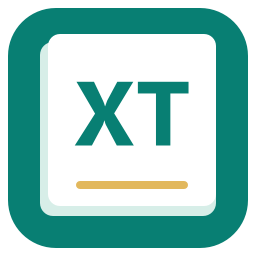

# XT 阅迹 · XT-ReadTrace



XT（XuTao）的个人英文 PDF 精读与词本工具。**读一页，记一点。**

Windows 本地运行，支持连续阅读、双页并排、离线英汉查词、单词与词组标记、墨墨背单词云词本导出，以及方便打印手写的精读留白 PDF。

## 直接使用

从本私密仓库的 [Releases](https://github.com/peekabooXT/XT-ReadTrace/releases) 下载 **Windows 安装包** `XT-ReadTrace-1.9.0-Setup-x64.exe`，双击后按中文向导安装。安装包包含完整离线词典和 OCR 字库，并创建桌面与开始菜单入口，无需安装 Python 或另外下载词典。

也可下载原有 Windows 便携包，完整解压到英文目录，例如 `D:\tools\codex\XT-ReadTrace`，然后双击 **XT阅迹.exe**。日常使用无需联网。

请保留 `_internal` 和 `dictionary` 文件夹。软件启动后会在本机创建 `data` 和 `exports`；用户 PDF、标记、打开密码和导出记录不随源码或初始发布包上传。

完整操作说明见 [使用说明](使用说明.md)。[精读导出示例](精读导出示例.pdf) 展示每行之间增加书写留白的效果。

## 已有功能

- 导入文字版或扫描版英文 PDF，保留原始文件。
- 鼠标滚轮连续跨页，支持双页阅读、缩放、页码跳转和全文查找。
- 单击选词、拖选词组；双击直接标记，再次双击取消。
- 内置约 77 万条 ECDICT 词条，显示中文释义、音标和词形参考；词组未收录时逐词解释。
- 导出 UTF-8 墨墨背单词云词本正文，完整保留词组和大小写；可生成保留收录样式和论文批注的 PDF。
- 导出两列单词释义 PDF：左列英文、右列中文，可预览修改释义、合并重复或只导出选中词条，支持完整长释义分页打印。
- 精读导出支持每行增加 1 / 2 行留白、全部 / 当前 / 指定页码、A4 自动分页，以及可选标记高亮。
- 离线英文 OCR、加密 PDF、自动保存与本机备份。

## 从源码运行

使用独立 CPython 3.12+，建议避免 Anaconda 的 Qt DLL 冲突。仓库内已包含压缩的离线词典；首次准备时会自动在本地解包，不需要下载词典。首次安装 Python 依赖通常仍需要联网。

```powershell
python -m venv .venv
.\.venv\Scripts\python.exe -m pip install -r .\src\requirements.txt
.\src\prepare_dictionary.ps1 -Python .\.venv\Scripts\python.exe
.\.venv\Scripts\python.exe .\src\app.py
```

`dictionary/ecdict.sqlite.gz` 包含完整的 770,611 条 ECDICT 词条。准备脚本优先离线解包，并校验压缩文件与解包数据库的 SHA-256；解包后的 `ecdict.sqlite` 不重复写入 Git 历史。Windows 发布包直接包含已解包数据库。英文 OCR 字库在 `tessdata` 中。

如果两份数据库都缺失，准备脚本才会尝试下载固定版本的公开 ECDICT CSV 并校验其 SHA-256 后重建。MIT 许可和数据来源随词典一同保存。

## 构建与验证

```powershell
.\src\build.ps1 -Python python
.\tests\run_checks.ps1 -Python .\.venv\Scripts\python.exe
```

使用 Inno Setup 6.7+ 可以把完整便携目录进一步打包成安装程序：

```powershell
.\installer\build-installer.ps1 -ISCC 'C:\Program Files (x86)\Inno Setup 6\ISCC.exe' -Payload '完整便携目录路径'
```

安装脚本只包含程序、字库、词典、源代码、许可和示例，不收录 `data`、`exports`、`.git` 或测试临时文件。安装升级不会覆盖个人文档数据；卸载后 `data` 和 `exports` 保留。更新旧便携版时选择原目录即可；安装向导要求英文目录以兼容离线 OCR。

构建脚本输出完整便携目录。验证覆盖鼠标选词、双击、连续双页、OCR、离线词典、精读留白、分页、密码保护和取消导出等行为。测试使用生成的示例与独立临时词库，不读取个人 PDF。

## 保存与更新

关闭软件后备份 `data` 文件夹。更新时保留或迁移 `data`，再替换程序、运行库和词典。数据结构保持兼容，现有词条、批注和快捷键设置可以继续使用。

## 许可与范围

软件源码按 **GNU AGPLv3** 提供，见 [LICENSE](LICENSE)；第三方组件保持各自许可，见 [第三方说明](第三方说明.txt)。ECDICT 使用 MIT 许可，其固定版本、来源和校验值见 `dictionary/source.json`。

扫描 OCR、复杂多栏、表格、公式和生僻词可能需要人工核对。离线查词不提供整句机器翻译。本项目不是墨墨背单词官方软件，不登录墨墨背单词，也不自动上传词本。

## v1.7.0 论文批注

已收录词条改为青绿加粗和下划线；普通批注独立提供文字高亮、下划线、自由画笔、矩形框与中文文字备注，支持颜色、线宽、撤销重做、删除管理及自动保存。点击「导出收录与批注 PDF」生成保留标准 PDF 批注的副本。墨墨背单词 TXT 和两列释义表仍只包含收录词条。

## 导航与快捷键

七个阅读与批注工具全部展开为导航按钮，窄窗口保持单排并支持横向滚动。默认数字 1–7 依次切换选词 / 阅读、文字高亮、文字下划线、自由画笔、矩形框、文字备注、橡皮擦。右上角「设置」可修改、清空或恢复工具快捷键，自动检测重复及已有功能的冲突；设置保存在本机，重开软件后有效。文本输入、页码输入和设置录入时不会触发切换。

## 统一命名与单排导航

产品名为 **XT 阅迹**，项目名为 **XT-ReadTrace**。程序、安装器、目录、仓库、PDF 导出元数据和开发规范统一使用该名称，详见 [命名规范](NAMING.md)。全部工具与颜色、线宽、撤销、重做、批注管理处于同一排；窄窗口可横向滚动，数字快捷键继续有效。
